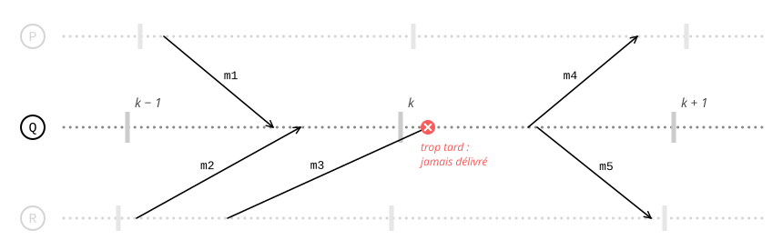
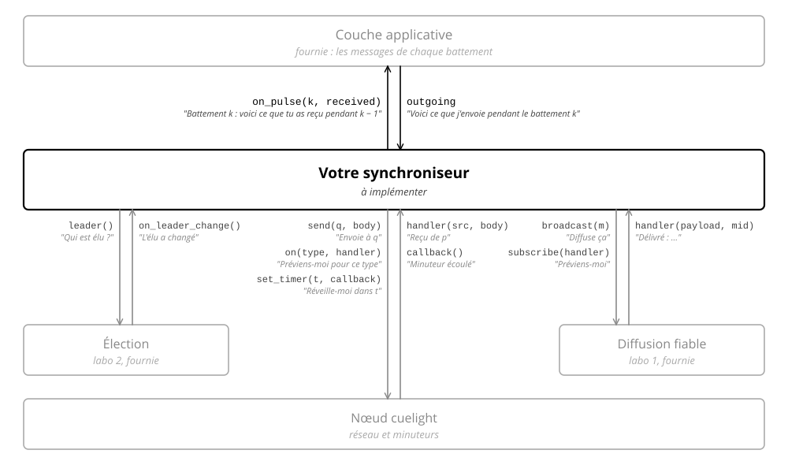

## Informations Générales
- **Lien vers le labo sur Roster** : communiqué en séance.
- **Groupes de deux ou seul.e**. Vous êtes libres de changer par rapport au labo 2.
- **Langage** : libre. Boilerplate fournis en Python, Java, Go et C++, mais tout autre langage capable de lire et écrire des lignes sur `stdin`/`stdout` convient aussi.
- **Prérequis** : Installation de **Rust** (`rustup`), pour les outils d'évaluation.
- **Plagiat** : lors de l'évaluation de vos rendus, nous utiliserons des outils de détection de plagiat (entre groupes, mais aussi avec les rendus des années précédentes et la solution officielle).
  En cas de suspicion, vous y serez confronté.e.s, et l'incident pourra être rapporté au responsable
  de la filière, avec un risque d'échec immédiat au cours.
- **IA générative** : **le moyen d'arriver au rendu est entièrement libre.** En revanche, nous attendons un ownership complet de votre rendu. Vous devez posséder et savoir défendre tous les choix architecturaux et
  algorithmiques de votre solution (pourquoi ces choix, pourquoi pas d'autres), ainsi que réfléchir sur la base de votre solution (comment vous approcheriez telle ou telle nouvelle contrainte).

  Dans cette optique, chaque fin de labo sera suivie d'un *quiz individuel* qui testera précisément cette contrainte.

Notez enfin que l'objectif étant pour vous d'apprendre, vous serez toujours légitimes et
bienvenu.e.s à nous poser des questions : sur la théorie, sur vos idées, sur vos blocages. Si vous
vous sentez perdu.e.s ou coincé.e.s, c'est qu'il faut nous demander.

## Le fil rouge du semestre

Rappelez-vous le [fil rouge du semestre](https://sdr-classroom.github.io/labos/1-diffusion-fiable-et-mutex.html#le-fil-rouge-du-semestre). Au labo 2, vous avez élu un leader dans un monde où les pannes sont possibles. Ce labo est la troisième étape : **utiliser le leader pour synchroniser les processus.** Au labo 4, cette synchronisation servira à atteindre le consensus.

**Ce labo s'appuie sur les deux précédents, mais n'en dépend pas.** Votre couche utilise l'élection du labo 2, et peut utiliser la diffusion fiable du labo 1. Le repo qu'on vous remet contient les nôtres, et c'est sur elles que votre rendu est évalué ; un labo 1 ou 2 raté ne vous coûte rien ici. Vous pouvez aussi les remplacer par les vôtres, telles quelles ou améliorées, mais cela ne rapporte aucun point.

---

## Les suppositions

- **Réseau** : le réseau est un graphe pleinement connecté ; tout processus peut envoyer un message à tout autre processus.
- **Messages** : aucune perte, duplication ou réordonnancement.
- **Processus** : leur nombre est variable, et le code que nous vous fournissons vous y donne accès. Si vous utilisez un langage pour lequel nous ne proposons pas de code de départ, référez-vous à `LAYERS.md`, dans le repo qu'on vous remet.
- **Pannes** **permanentes** : un processus qui tombe en panne ne redémarre jamais. **Moins de la moitié des processus** peuvent tomber en panne.
- **Réseau partiellement synchrone** : une borne sur la durée de transit des messages existe mais vous est inconnue.
- **Diffusion fiable** : la couche fournie garantit que si un processus correct délivre un message, tous les processus corrects le délivrent.
- **Élection** : la couche fournie garantit qu'un jour, `leader()` retourne le même processus correct chez tous les processus corrects. Avant ce jour, elle peut retourner n'importe quel processus, et pas forcément le même partout.

---

## Le synchroniseur

Vous avez vu en cours ce qu'est un algorithme synchrone : les processus avancent par **battements**. Dans chaque battement, un processus peut envoyer **au plus un message à chaque autre processus**, éventuellement un message différent à chacun, éventuellement aucun ; il reçoit ceux qui lui ont été envoyés dans ce battement, et s'en sert au battement suivant.

Vous implémenterez un synchroniseur : une couche qui fait avancer les battements `0, 1, 2, …` pour la couche du dessus. Au début de chaque battement `k`, votre couche délivre à la couche du dessus les messages envoyés pour le battement `k − 1`, et envoie ceux qu'elle lui retourne pour le battement `k`.

Les synchroniseurs alpha et beta vus en cours ne tolèrent aucune panne : même une panne bloque les battements pour toujours. Le vôtre doit continuer d'avancer malgré les pannes. Vous verrez vite que, par conséquent, certains messages, au début, risquent nécessairement de ne pas être reçus dans le bon battement ; ils doivent alors être ignorés et sont perdus. C'est le prix à payer de la tolérance aux pannes.

Votre couche doit garantir les propriétés suivantes :

- **Intégrité** - un message est délivré à la couche du dessus au plus une fois, seulement s'il a été envoyé, et lors du passage au battement qui suit le battement dans lequel il a été envoyé.
- **Ordre** - chaque processus passe par les battements `0, 1, 2, …` dans l'ordre, sans en sauter ni en répéter aucun.
- **Progrès** - tout processus correct passe par tous les battements.
- **Synchronie** - un jour, tout message envoyé par un processus correct à un processus correct est délivré lors du passage au battement suivant.

Notez que parce que la Synchronie est "un jour", des messages peuvent être perdus avant un certain battement, notamment pendant que le réseau est lent ou que l'élection ne s'est pas encore stabilisée. C'est seulement une fois le réseau et l'élection stabilisées qu'aucun message ne doit plus l'être.

---

## Contraintes sur votre solution

Les propriétés ci-dessus disent ce qu'est un synchroniseur correct. Elles ne suffisent pas pour que votre solution soit acceptée ; nous exigeons en plus les contraintes suivantes.

1. Votre solution doit être telle que **c'est un élu qui a la responsabilité de décider quand passer au battement suivant**.
2. Sur un réseau calme, avec ou sans pannes, **la durée des battements cesse de croître**.

Enfin, **la durée initiale d'un battement, comme celle de tout délai de suspicion de panne, ne doit pas dépasser 400 unités de temps.**

Pour votre information, un ordre de grandeur : sur un réseau calme et rapide, un message met **une vingtaine d'unités de temps** à arriver. D'autres réseaux peuvent être plus lents, ou connaitre des pics de délai. La borne sur la durée de transit reste, quoi qu'il arrive, inconnue.

Notez aussi qu'un processus ne remet pas tous ses messages au réseau au même instant : ils partent l'un après l'autre, et écrire à tous les autres peut prendre jusqu'à une centaine d'unités de temps.

**Un indice** : un message *peut* arriver après la fin du battement auquel il était destiné. Il n'est alors pas délivré, mais son arrivée retardée *est une information de valeur*.

---

## L'interface avec l'outillage

L'outillage est celui des labos 1 et 2 : votre programme est le comportement d'*un* processus, il lit ses événements sur `stdin` et écrit les siens sur `stdout`, et `cuelight` simule le réseau entre les processus.

Si vous utilisez notre squelette, vous n'aurez que les points suivants à implémenter :

- le constructeur de la couche est appelé une fois, au démarrage du processus. Il reçoit le nœud (`node`), la diffusion fiable, l'élection, et `on_pulse`. La couche commence aussitôt, mais ne doit pas appeler `on_pulse` depuis le constructeur : à ce moment-là, celui qui construit votre couche ne la tient pas encore.
- `on_leader_change()` est appelée, sans argument, chaque fois que l'élection se met à nommer un autre processus. L'interface de l'élection est celle du labo 2 : c'est la fonction que le point d'entrée lui donne à sa construction.
- `on_pulse(k, received)` est une fonction qui vous est fournie, et que **vous** devez appeler au début de chaque battement `k` :
  - `received` contient les messages reçus durant le battement `k − 1`, avec leur expéditeur (vide pour `k = 0`) ;
  - elle retourne les messages à envoyer pour le battement `k`, avec leur destinataire, éventuellement aucun. Comme tout message, ils peuvent être perdus pour leur battement : votre couche ne garantit pas de les délivrer.

C'est par ces appels que nous apprenons quels battements vous traversez, et ce que vous délivrez à chacun.

---

## Une contrainte technique

Elle est la même qu'aux labos 1 et 2, et pour la même raison : au labo suivant, nous pourrons remplacer cette couche par notre propre implémentation.

1. **Votre nœud doit être une fonction pure des événements.** Pas d'horloge système, pas de threads, pas d'aléatoire non initialisé. C'est ce qui rend une exécution rejouable, et c'est vérifié avant tout le reste : si votre code ne se rejoue pas à l'identique, rien d'autre n'est évalué.
2. **Aucune opération n'est autorisée à bloquer en attendant une réponse.** Votre processus est un gestionnaire d'événements mono-thread, et le temps logique n'avance qu'une fois que l'événement est traité. Si une de vos fonctions bloque, alors le temps arrête d'avancer.

Concrètement : attendre la fin d'un battement ne veut pas dire bloquer. Cela veut dire armer un minuteur, retourner, et décider de la suite lorsqu'il se déclenche ou lorsqu'un message arrive.

## Évaluation

Nous vous fournissons le vérificateur `lab3-check`, que vous construisez vous-même et qui exécute tous les tests fournis avec le code. Ces tests sont des scénarios décrivant une séquence de pannes, de ralentissements et de changements d'aptitude, donc d'élu. Leur exécution dépend d'une graine (seed) : pour chaque graine, les pannes et les délais sont différents. `lab3-check` exécute les 200 premières graines de chacun ; nous en exécuterons d'autres lors de l'évaluation de votre rendu.

Référez-vous au README de votre repo pour plus de détails sur la construction et l'exécution de `lab3-check`.

Votre rendu sera évalué sur ces tests, sur la relecture de votre code pour la première contrainte, ainsi que sur un quiz individuel juste après le rendu. L'objectif sera de vérifier que vous possédez les choix architecturaux, logiques et algorithmiques de votre solution, et que vous avez compris leurs enjeux. Le quiz sera donné sur Opendidac, d'une durée de 30 minutes max et sans accès à votre code.

Vous ajouterez à votre README une section décrivant votre utilisation de l'IA : ce qu'elle a fait, quelles responsabilités vous avez gardées et lesquelles vous lui avez déléguées, etc. Elle est demandée par souci de transparence, et ne sera pas un critère d'évaluation.

Votre note finale sera égale à `min(labo, quiz + 1.5)`, où `labo` et `quiz` sont votre note sur 6 au labo et au quiz, respectivement.
